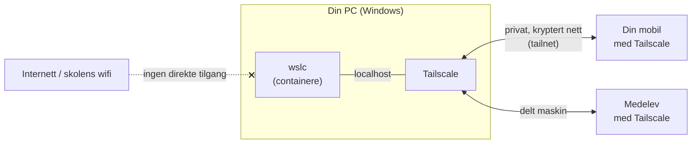

# Drift din egen tjeneste med WSL-containere

Velkommen! I dette opplegget skal du kjøre ekte serverprogramvare på din egen PC. Du bruker **wslc**, som er Windows sitt innebygde verktøy for Linux-containere.

Du velger selv hvilket prosjekt du vil gjøre. Blir du ferdig, kan du gjerne ta ett til.

## Slik bruker du denne siden

1. **Alle starter med [Kom i gang](00-kom-i-gang.md).** Der gjør du PC-en klar, installerer Tailscale og tester at alt virker. Ingen prosjekter fungerer uten dette.
2. **Velg prosjekt** i tabellen under, og følg instruksjonene steg for steg.
3. **Før driftslogg** mens du jobber. Bruk [malen for driftslogg](driftslogg-mal.md).
4. Står du fast? Se [Feilsøking](feilsoking.md) og [Jukselappen](jukselapp.md) før du spør læreren.

## Velg prosjekt

| Prosjekt | Hva du lager | Fagområde | Vanskelighetsgrad | Tid (ca.) |
| --- | --- | --- | --- | --- |
| [1 – Egen bildesky](prosjekt-1-bildesky/README.md) | Ditt eget «Google Foto» med Immich. Mobilen tar backup automatisk, og du undersøker hvem som kan se hvilke bilder | Drift og media | ★★★ Krevende | 5–6 økter |
| [2 – Spillserver for klassen](prosjekt-2-spillserver/README.md) | En Minecraft- eller Luanti-server som medelevene dine kan spille på | Drift | ★★☆ Middels | 3–4 økter |
| [3 – Egen strømmetjeneste](prosjekt-3-strommetjeneste/README.md) | Ditt eget «Netflix» med Jellyfin, fylt med egne filmer og medieproduksjoner | Media og drift | ★☆☆ Lett | 3–4 økter |

**Tips:** Har du ikke jobbet med containere før? Start med prosjekt 3 eller 2. Prosjekt 1 består av fire containere som må snakke sammen, så det er lurt å ha gjort ett av de andre først.

## Slik henger det sammen

Alle prosjektene bygger på samme idé. Tjenesten kjører i containere på PC-en din. Tailscale lager et privat nettverk, slik at mobilen din og medelever kan nå tjenesten, selv om skolens wifi stopper trafikk direkte mellom elevmaskiner.

## Hva du skal levere (alle prosjekter)

- [ ] **Driftslogg** med kommandoene du brukte, feil du møtte og hvordan du løste dem
- [ ] **Skjermbilder** som viser at tjenesten virker, både på PC og på mobil eller medelevens PC
- [ ] **Tegning** av oppsettet ditt: containere, porter, volumer og nettverk
- [ ] **Svar på refleksjonsspørsmålene** nederst i prosjektet du valgte
- [ ] **Kort demo** for læreren eller klassen

> **Viktig om GitHub:** Hvis du legger driftsloggen din på GitHub, må du **aldri** ta med passord, Tailscale-lenker eller invitasjonslenker. Skriv `********` i stedet.

## Regler for hele opplegget

- Ingen tjeneste skal være åpen på det åpne internettet uten at læreren har godkjent det.
- Bruk egne bilder, egen musikk og egne videoer, eller innhold med fri lisens (for eksempel Creative Commons).
- Bruk sterke passord, også på testkontoer.
- Følg skolens regler for nettverk og utstyr.

---

*For lærere: se [veiledning for læreren](for-laereren.md).*
