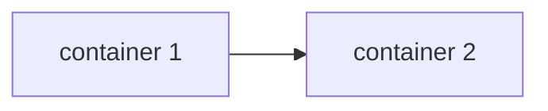

# Driftslogg – mal

[← Tilbake til hovedsiden](README.md)

Kopier denne filen og fyll den ut mens du jobber. En god driftslogg gjør at du, eller noen andre, kan sette opp tjenesten på nytt uten å gjette.

> **Aldri skriv passord, invitasjonslenker eller delingslenker i en logg som skal på GitHub.** Skriv `********` i stedet, og ha de ekte verdiene et trygt sted, for eksempel i en passordbehandler.

---

## Om oppsettet

| | |
| --- | --- |
| **Navn** | |
| **Prosjekt** | |
| **Maskinnavn i Tailscale** | |
| **Tailscale-IP** | 100. |
| **Adresse til tjenesten** | https:// |

### Containere

| Navn | Image | Porter | Volumer | Nettverk |
| --- | --- | --- | --- | --- |
| | | | | |

### Tegning av oppsettet

*Lim inn en tegning, eller lag den med Mermaid:*



---

## Logg per økt

### Økt 1 – dato:

**Mål for økta:**

**Hva jeg gjorde:**

```powershell
# kommandoene jeg kjørte
```

**Problemer og løsninger:**

| Problem | Feilmelding / logg | Hva jeg prøvde | Løsning |
| --- | --- | --- | --- |
| | | | |

**Skjermbilder:**

### Økt 2 – dato:

*(samme oppsett)*

---

## Startinstruks

*Hvordan starter man tjenesten etter at PC-en har vært slått av? Skriv det så enkelt at en medelev kan gjøre det.*

1.
2.

## Refleksjon

*Svar på refleksjonsspørsmålene som står nederst i prosjektet ditt.*
