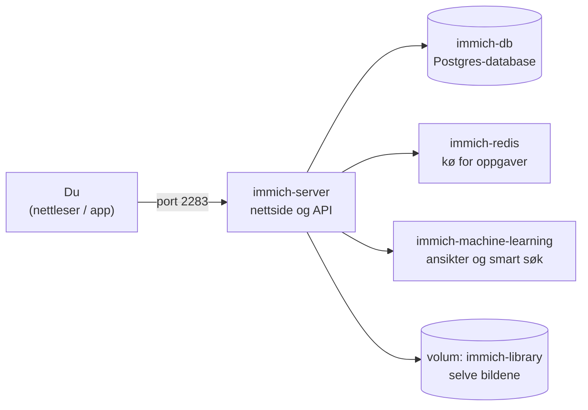

# Prosjekt 1 – Egen bildesky med Immich og Tailscale

[← Tilbake til hovedsiden](../README.md) · [Jukselapp](../jukselapp.md) · [Feilsøking](../feilsoking.md)

Du lager ditt eget «Google Foto» som kjører på PC-en din. Mobilen tar backup av bildene dine over et privat nettverk. Til slutt undersøker du nøyaktig **hvem som kan se hvilke bilder**, og hvorfor.

**GitHub-prosjekt:** [immich-app/immich](https://github.com/immich-app/immich)

| | |
| --- | --- |
| **Vanskelighetsgrad** | ★★★ Krevende – fire containere som må snakke sammen |
| **Du lærer** | Oversette en compose-fil, nettverk mellom containere, volumer, miljøvariabler, HTTPS, tilgangsstyring og personvern |
| **Resultat** | En bildesky med automatisk backup fra mobilen, og en undersøkelse av deling med testresultater |
| **Før du starter** | Du må ha gjort alt i [Kom i gang](../00-kom-i-gang.md) |

### Sjekkliste

- [ ] Del A – Forstå oppsettet
- [ ] Del B – Lag nettverk, volumer og passord
- [ ] Del C – Start de fire containerne
- [ ] Del D – Første innlogging
- [ ] Del E – Koble til mobilen med Tailscale
- [ ] Del F – Undersøk deling: hvem ser hva?
- [ ] Del G – Drift: startskript og omstart
- [ ] Refleksjon og levering

---

## Del A – Forstå oppsettet

Immich består av fire deler som jobber sammen:



Immich-utviklerne beskriver oppsettet i en **compose-fil**. wslc kan ikke kjøre compose-filer ennå, så du må oversette den til wslc-kommandoer selv.

1. Last ned compose-filen: [docker-compose.yml](https://github.com/immich-app/immich/releases/latest/download/docker-compose.yml). Den blir lagret i **Nedlastinger**.
2. Last ned innstillingsfilen også: [example.env](https://github.com/immich-app/immich/releases/latest/download/example.env).
3. Åpne begge filene i Notisblokk eller VS Code.
4. Fyll ut denne tabellen i driftsloggen din:

   | Tjeneste i compose-filen | Image | Porter | Volumer | Miljøvariabler |
   | --- | --- | --- | --- | --- |
   | immich-server | | | | |
   | immich-machine-learning | | | | |
   | redis | | | | |
   | database | | | | |

5. Bruk tabellen «Fra docker-compose.yml til wslc» i [jukselappen](../jukselapp.md) og prøv å skrive wslc-kommandoene selv.
6. Sammenlign med fasiten i del B og C. Hva hadde du likt, og hva var annerledes?

<details>
<summary>Hint: hva er <code>${DB_PASSWORD}</code> i compose-filen?</summary>

Alt som står som `${NOE}` hentes fra `.env`-filen. Se i `example.env` hva `DB_USERNAME`, `DB_DATABASE_NAME` og `IMMICH_VERSION` er satt til.
</details>

---

## Del B – Lag nettverk, volumer og passord

**1. Lag et nettverk**, så containerne kan finne hverandre på navn:

```powershell
wslc network create immich-net
```

**2. Lag tre volumer.** Her lagres dataene, så de ikke forsvinner når en container slettes:

```powershell
wslc volume create immich-db
wslc volume create immich-library
wslc volume create immich-model-cache
```

**3. Lag et databasepassord.** Det skal bare inneholde bokstaver og tall:

```powershell
$DbPass = -join ((48..57) + (65..90) + (97..122) | Get-Random -Count 24 | ForEach-Object { [char]$_ })
$DbPass
```

Ta vare på passordet et trygt sted (ikke på GitHub!). Du trenger det hvis du må lage containerne på nytt.

> `$DbPass` er en PowerShell-variabel. Den forsvinner når du lukker Terminal. Lukker du Terminal før del C er ferdig, må du sette den igjen: `$DbPass = "passordet-ditt"`.

---

## Del C – Start de fire containerne

Rekkefølgen er viktig: Serveren trenger databasen, så databasen må startes først.

> Kopier hele kodeblokken. Tegnet `` ` `` på slutten av linjene betyr at kommandoen fortsetter på neste linje.

### C1 – Databasen

```powershell
wslc run -d --name immich-db --network immich-net `
  -e POSTGRES_USER=postgres `
  -e POSTGRES_PASSWORD=$DbPass `
  -e POSTGRES_DB=immich `
  -e POSTGRES_INITDB_ARGS="--data-checksums" `
  -v immich-db:/var/lib/postgresql/data `
  --shm-size 128M `
  ghcr.io/immich-app/postgres:14-vectorchord0.4.3-pgvectors0.2.0
```

Vent til databasen er klar:

```powershell
wslc logs -f immich-db
```

Når du ser `database system is ready to accept connections`, trykker du `Ctrl` + `C`.

### C2 – Redis (oppgavekø)

```powershell
wslc run -d --name immich-redis --network immich-net docker.io/valkey/valkey:9
```

### C3 – Maskinlæring

Containeren **må** hete `immich-machine-learning`. Serveren leter nemlig etter den på akkurat det navnet.

```powershell
wslc run -d --name immich-machine-learning --network immich-net `
  -v immich-model-cache:/cache `
  ghcr.io/immich-app/immich-machine-learning:v3
```

### C4 – Serveren

```powershell
wslc run -d --name immich-server --network immich-net `
  -p 2283:2283 `
  -e DB_HOSTNAME=immich-db `
  -e DB_USERNAME=postgres `
  -e DB_PASSWORD=$DbPass `
  -e DB_DATABASE_NAME=immich `
  -e REDIS_HOSTNAME=immich-redis `
  -e TZ=Europe/Oslo `
  -v immich-library:/data `
  ghcr.io/immich-app/immich-server:v3
```

Følg med på oppstarten:

```powershell
wslc logs -f immich-server
```

Når du ser en linje om at serveren lytter på port 2283 («listening»), trykker du `Ctrl` + `C`.

### C5 – Sjekk at alt kjører

```powershell
wslc list
wslc stats
```

Du skal se fire containere. Skriv ned i driftsloggen hvor mye minne hver av dem bruker.

<details>
<summary>Én av containerne har stoppet – hva gjør jeg?</summary>

1. Finn ut hvilken: `wslc list --all`
2. Les loggen: `wslc logs NAVN`
3. Startet serveren før databasen var klar? Da holder det med `wslc start immich-server`.
4. Står det noe om passord, er det sannsynligvis `$DbPass` som var tom. Slett serveren med `wslc rm -f immich-server`, sett `$DbPass` på nytt, og kjør C4 igjen.
</details>

**Spørsmål til driftsloggen:** Hvorfor har bare `immich-server` en `-p`-port? Hva ville risikoen vært om databasen også hadde åpen port?

---

## Del D – Første innlogging

> Immich er på engelsk som standard, så menynavnene i denne instruksjonen er på engelsk. Menyene kan hete litt annerledes i nyere versjoner. Let litt rundt hvis du ikke finner noe med en gang.

1. Åpne **http://localhost:2283** i nettleseren.
2. Trykk **Getting Started** og lag administratorkontoen din.
3. Last opp 10–20 egne bilder (dra dem inn i nettleservinduet).
4. Vent et par minutter. Søk så etter noe som er på bildene, for eksempel «dog», «snow» eller «car». Det er maskinlæringscontaineren som gjør dette mulig.
5. Se under **Administration** → **Jobs** at oppgavene blir ferdige.

📸 *Skjermbilde til driftsloggen: bildebiblioteket ditt og et smart søk som fungerer.*

---

## Del E – Koble til mobilen med Tailscale

**1. Gjør Immich tilgjengelig i tailnettet ditt:**

```powershell
tailscale serve --bg 2283
```

Kommandoen skriver ut en adresse, for eksempel `https://im-pc-kari.tail1234.ts.net/`. Skriv den ned.

**2. Fortell Immich hva adressen er.** Da blir delingslenker riktige:
**Administration** → **Settings** → **Server Settings** → **External Domain** → lim inn adressen → **Save**.

**3. Test på mobilen:** Slå på Tailscale og åpne adressen i nettleseren. Du skal få opp Immich.

**4. Installer Immich-appen** fra App Store eller Google Play.

- Server-adresse: adressen fra punkt 1
- Logg inn med kontoen din

**5. Slå på backup** i appen, men **velg bare ett album**, for eksempel et testalbum med 20–30 bilder. Ikke ta backup av hele kamerarullen på skolens wifi.

📸 *Skjermbilde til driftsloggen: bildene fra mobilen vises i Immich på PC-en.*

---

## Del F – Undersøk deling: hvem ser hva?

Nå kommer hoveddelen av prosjektet. Deling har **to lag**:

1. **Immich** bestemmer hvem som har *lov* til å se bildene.
2. **Nettverket** bestemmer hvem som i det hele tatt *når* serveren.

Du skal teste begge lagene og fylle ut tabellen under.

### F1 – Lag en testbruker

**Administration** → **Users** → **Create user**. Kall den for eksempel «Testbruker». Logg inn som testbrukeren i et **privat/inkognito-vindu**, så du kan være innlogget som begge samtidig.

### F2 – Test de fire delingsnivåene i Immich

| # | Test | Slik gjør du | Hva tror du skjer? | Hva skjedde? |
| --- | --- | --- | --- | --- |
| 1 | **Privat** | Testbrukeren leter etter bildene dine | | |
| 2 | **Delt album** | Lag et album, og del det med testbrukeren | | |
| 3 | **Partnerdeling** | Profilbildet → **Account Settings** → **Partner Sharing** → legg til testbrukeren | | |
| 4 | **Offentlig delt lenke** | Åpne et album → del-knappen → **Create link**. Åpne lenken i inkognito, *uten* å logge inn | | |
| 5 | **Lenke med passord og utløpstid** | Lag en ny lenke med passord og utløp om 1 time | | |

**Spørsmål:** Hva er forskjellen på delt album og partnerdeling? Når ville du brukt hver av dem?

### F3 – Test nettverkslaget

Bruk den **offentlige lenken** fra test 4.

| # | Test | Hva tror du skjer? | Hva skjedde? |
| --- | --- | --- | --- |
| 6 | Åpne lenken på mobilen **med** Tailscale på | | |
| 7 | Slå av wifi og Tailscale på mobilen, og åpne lenken over mobilnett | | |
| 8 | Del PC-en med en medelev i Tailscale ([Kom i gang, steg 7](../00-kom-i-gang.md#steg-7--lær-deg-å-dele-maskinen-med-en-medelev)). Send lenken. Kan medeleven åpne den? | | |
| 9 | En medelev **uten** delt maskin prøver lenken | | |

**Det viktige poenget:** Lenken kalles «offentlig» i Immich, men så lenge du bruker `tailscale serve`, er serveren bare synlig i ditt private tailnet. Nettverket fungerer som en ekstra lås.

### F4 – Offentlig på internett (bare med læreren til stede)

Med `tailscale funnel` blir tjenesten tilgjengelig for **hele internett**. Da blir en offentlig lenke virkelig offentlig. **Gjør bare dette med læreren til stede, og slå det av med en gang etterpå.**

1. Sjekk at lenken du skal teste har **passord** og **utløpstid**.
2. Slå på Funnel:

   ```powershell
   tailscale funnel --bg 2283
   ```

   Får du en melding om at Funnel ikke er slått på, følger du lenken i meldingen for å skru det på i admin console.

3. Test lenken over mobilnett uten Tailscale (test 7 på nytt). Hva skjer nå?
4. **Slå av med en gang**, og gå tilbake til bare tailnet:

   ```powershell
   tailscale serve reset
   tailscale serve --bg 2283
   tailscale serve status
   ```

   Status skal **ikke** si «Funnel on».

**Spørsmål:** Hvorfor er det ekstra viktig med sterke passord på kontoene og lenkene når Funnel er på?

---

## Del G – Drift: startskript og omstart

Containere starter ikke av seg selv etter omstart. Lag et skript som gjør det for deg.

1. Lag filen `start-immich.ps1` i Dokumenter-mappen din med dette innholdet:

   ```powershell
   # Starter Immich i riktig rekkefølge
   Write-Host "Starter databasen og redis..."
   wslc start immich-db
   wslc start immich-redis
   Start-Sleep -Seconds 15

   Write-Host "Starter maskinlæring og server..."
   wslc start immich-machine-learning
   wslc start immich-server

   wslc list
   Write-Host "Ferdig! Åpne http://localhost:2283"
   ```

2. Første gang må du tillate skript på PC-en. Det gjør du én gang i vanlig Terminal:

   ```powershell
   Set-ExecutionPolicy -Scope CurrentUser RemoteSigned
   ```

3. **Test det:** Start PC-en på nytt. Åpne Terminal, og kjør:

   ```powershell
   & "$env:USERPROFILE\Documents\start-immich.ps1"
   ```

   Er alle bildene der fortsatt? Hvorfor?

**Utfordring (valgfritt):** Ta backup av databasen:

```powershell
wslc exec immich-db pg_dumpall --clean --if-exists --username=postgres | Out-File -Encoding utf8 immich-backup.sql
```

Hvor stor ble filen? Hva er forskjellen på å ta backup av *databasen* og av *bildene*?

---

## Refleksjon

Svar i driftsloggen:

1. Tegn oppsettet ditt med alle fire containere, nettverket, volumene og Tailscale.
2. Hvorfor ligger bildene og databasen i *volumer* og ikke inne i containerne?
3. Forklar de to lagene i deling (appen og nettverket) med egne ord. Bruk testresultatene dine.
4. Hvilke bilder ville du delt med en offentlig lenke, og hvilke ville du *aldri* delt slik? Hvorfor?
5. Hva er fordelene og ulempene ved å ha bildene dine på egen server, sammenlignet med Google Foto eller iCloud?

## Rydde opp (når prosjektet er levert)

Bare gjør dette hvis du vil slette alt. **Bildene forsvinner for godt.**

```powershell
tailscale serve reset
wslc rm -f immich-server immich-machine-learning immich-redis immich-db
wslc volume rm immich-db immich-library immich-model-cache
wslc network rm immich-net
```

---

[← Tilbake til hovedsiden](../README.md)
