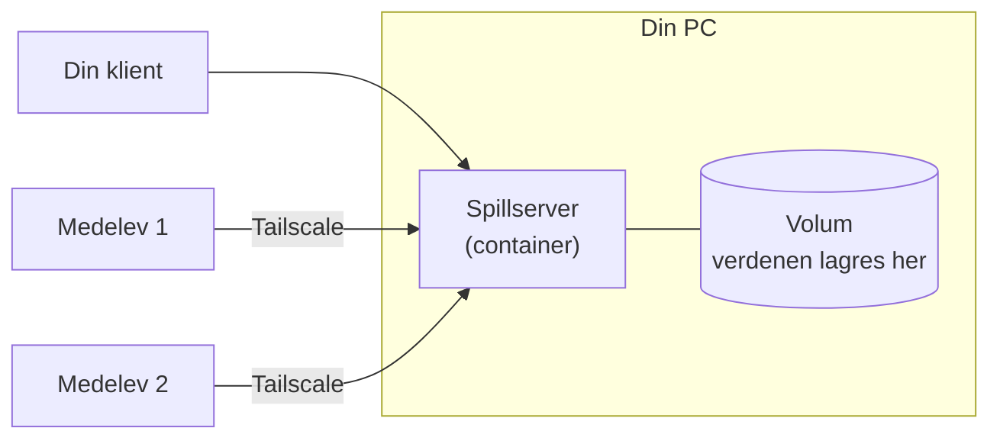

# Prosjekt 2 – Spillserver for klassen

[← Tilbake til hovedsiden](../README.md) · [Jukselapp](../jukselapp.md) · [Feilsøking](../feilsoking.md)

Du drifter en ekte spillserver på PC-en din, og medelevene dine kobler seg til og spiller. Underveis lærer du om porter, volumer, innstillinger med miljøvariabler, tilgangsstyring og backup. Dette er de samme tingene som driftsfolk jobber med hver dag.

| | |
| --- | --- |
| **Vanskelighetsgrad** | ★★☆ Middels |
| **Du lærer** | Miljøvariabler, porter (TCP og UDP), volumer, brannmur, logger, whitelist og admin-rettigheter, backup |
| **Resultat** | En spillserver med whitelist, admin og testet backup, og en driftsinstruks som en medelev kan følge |
| **Før du starter** | Du må ha gjort alt i [Kom i gang](../00-kom-i-gang.md) |

---

## Velg spill

| | Minecraft Java | Minecraft Bedrock | Luanti |
| --- | --- | --- | --- |
| **Spilles på** | PC (Windows, Mac, Linux) | Windows, mobil, nettbrett | PC og Android |
| **Koster** | Spillet må kjøpes | Spillet må kjøpes. Trenger gratis Microsoft-konto | Gratis, åpen kildekode |
| **GitHub** | [itzg/docker-minecraft-server](https://github.com/itzg/docker-minecraft-server) | [itzg/docker-minecraft-bedrock-server](https://github.com/itzg/docker-minecraft-bedrock-server) | [luanti-org/luanti](https://github.com/luanti-org/luanti) |
| **Nettverk** | TCP – enklest | TCP + mange UDP-porter – vanskeligst | UDP |
| **Brannmurregel** | Ikke nødvendig | Ja | Ja |
| **Gå til** | [Del B – Java](#del-b-java--minecraft-java) | [Del B – Bedrock](#del-b-bedrock--minecraft-bedrock) | [Del B – Luanti](#del-b-luanti--luanti) |

**Viktig:** Alle som skal spille sammen må ha samme spill. Snakk med de du vil spille med før du velger.

### Sjekkliste

- [ ] Del A – Forstå hvordan en spillserver fungerer
- [ ] Del B – Sett opp serveren (Java, Bedrock *eller* Luanti)
- [ ] Del C – Inviter medelever
- [ ] Del D – Drift: endringer, backup og omstart
- [ ] Del E – Gi serveren et ansikt (media)
- [ ] Refleksjon og levering

---

## Del A – Forstå hvordan en spillserver fungerer

En spillserver er et program som holder styr på verdenen og alle spillerne. Spillene på PC-ene og mobilene (klientene) kobler seg til serveren over nettverket.



Svar i driftsloggen før du begynner (bruk gjerne internett):

1. Hva er forskjellen på **TCP** og **UDP**? Hvorfor bruker mange spill UDP?
2. Hva er en **port**, og hvorfor trenger serveren en?
3. Hva skjer med verdenen hvis den ligger *inne i* containeren og containeren slettes? Hva skjer hvis den ligger i et *volum*?

---

## Del B Java – Minecraft Java

### B1 – Les dokumentasjonen

Åpne [dokumentasjonen for innstillinger](https://docker-minecraft-server.readthedocs.io/en/latest/configuration/server-properties/). Finn hva disse miljøvariablene gjør, og skriv det i driftsloggen: `EULA`, `TYPE`, `MEMORY`, `MOTD`, `DIFFICULTY`, `MODE`, `WHITELIST`, `OPS`.

### B2 – Start serveren

Bytt ut `DittMinecraftNavn` med brukernavnet ditt i Minecraft:

```powershell
wslc volume create mc-data

wslc run -d --name mc -p 25565:25565 `
  -e EULA=TRUE `
  -e TYPE=PAPER `
  -e MEMORY=3G `
  -e MOTD="IM-klassens server" `
  -e DIFFICULTY=normal `
  -e MODE=survival `
  -e WHITELIST="DittMinecraftNavn" `
  -e ENFORCE_WHITELIST=TRUE `
  -e OPS="DittMinecraftNavn" `
  -e TZ=Europe/Oslo `
  -v mc-data:/data `
  itzg/minecraft-server
```

> `EULA=TRUE` betyr at du godtar Mojangs lisensvilkår for serveren. Les dem gjerne: [minecraft.net/eula](https://www.minecraft.net/eula).

### B3 – Følg oppstarten

```powershell
wslc logs -f mc
```

Første gang tar det noen minutter, fordi serveren laster ned spillfiler og lager en ny verden. Når du ser `Done (…s)! For help, type "help"`, er serveren klar. Trykk `Ctrl` + `C`.

### B4 – Spill på din egen server

Start Minecraft Java → **Multiplayer** → **Add Server** → Server Address: `localhost` → **Done** → koble til.

📸 *Skjermbilde til driftsloggen: du er inne på serveren.*

### B5 – Styr serveren fra terminalen

Med `rcon-cli` sender du kommandoer til serveren uten å være inne i spillet:

```powershell
wslc exec mc rcon-cli list
wslc exec mc rcon-cli say Hei fra driftsavdelingen!
wslc exec mc rcon-cli time set day
wslc exec mc rcon-cli whitelist add MedelevensNavn
wslc exec mc rcon-cli whitelist list
```

### B6 – Gjør serveren tilgjengelig i tailnettet

```powershell
tailscale serve --bg --tcp=25565 tcp://localhost:25565
tailscale serve status
```

Nå når de du deler PC-en med serveren din på `<maskin>.<tailnet>.ts.net`, for eksempel `im-pc-kari.tail1234.ts.net`.

➡️ **Gå videre til [Del C](#del-c--inviter-medelever).**

---

## Del B Bedrock – Minecraft Bedrock

> Bedrock er den vanskeligste varianten. Den bruker én TCP-port for å starte forbindelsen og en rekke UDP-porter for selve spillet. Les [README-en til prosjektet](https://github.com/itzg/docker-minecraft-bedrock-server), avsnittet **NetherNet**, før du begynner.

### B1 – Finn Tailscale-IP-en din

Serveren må fortelle klientene hvilken adresse de skal bruke. Vi bruker Tailscale-adressen:

```powershell
$TS = tailscale ip -4
$TS
```

Du skal få en adresse som begynner med `100.`.

### B2 – Åpne brannmuren (admin)

Åpne **Terminal (administrator)** og kjør disse to kommandoene. Reglene slipper bare inn trafikk fra Tailscale-adresser (`100.64.0.0/10`), ikke fra skolenettet:

```powershell
New-NetFirewallRule -DisplayName "Minecraft Bedrock TCP (Tailscale)" -Direction Inbound -Protocol TCP -LocalPort 19132 -RemoteAddress 100.64.0.0/10 -Action Allow
New-NetFirewallRule -DisplayName "Minecraft Bedrock UDP (Tailscale)" -Direction Inbound -Protocol UDP -LocalPort 19140-19149 -RemoteAddress 100.64.0.0/10 -Action Allow
```

**Lukk admin-vinduet** og gå tilbake til vanlig Terminal. Har du lukket den siden B1, må du kjøre `$TS = tailscale ip -4` på nytt.

### B3 – Start serveren

Første gang slår vi av allowlist (whitelist), så du kan finne din egen spiller-ID:

```powershell
wslc volume create bedrock-data

wslc run -d --name bedrock `
  -p "${TS}:19132:19132/tcp" `
  -p "${TS}:19140-19149:19140-19149/udp" `
  -e EULA=TRUE `
  -e SERVER_NAME="IM-klassens server" `
  -e GAMEMODE=survival `
  -e DIFFICULTY=normal `
  -e SERVER_UDP_PORTS="${TS}:19140-19149:19140-19149" `
  -e ALLOW_LIST=false `
  -e TZ=Europe/Oslo `
  -v bedrock-data:/data `
  itzg/minecraft-bedrock-server
```

Se at serveren starter: `wslc logs -f bedrock`. Avslutt med `Ctrl` + `C`.

**Test fra terminalen** at serveren svarer:

```powershell
curl.exe "http://${TS}:19132/v1/join"
```

Du skal få tilbake litt tekst (JSON) med navnet på serveren.

### B4 – Spill på din egen server

Start Minecraft → **Play** → **Servers** → **Add Server**:

- Server Name: hva du vil
- Server Address: Tailscale-IP-en din (`100.x.x.x`). Fordi serveren bare lytter på Tailscale-adressen, virker **ikke** `localhost`.
- Port: `19132`

📸 *Skjermbilde til driftsloggen: du er inne på serveren.*

### B5 – Slå på allowlist og gjør deg selv til operatør

1. Finn spiller-ID-en din (XUID) i loggen. Den står på linjen der du koblet til:

   ```powershell
   wslc logs bedrock | Select-String "xuid"
   ```

2. Slett containeren, men **ikke volumet**, og start den på nytt med allowlist. Bytt ut navn og XUID:

   ```powershell
   wslc rm -f bedrock

   wslc run -d --name bedrock `
     -p "${TS}:19132:19132/tcp" `
     -p "${TS}:19140-19149:19140-19149/udp" `
     -e EULA=TRUE `
     -e SERVER_NAME="IM-klassens server" `
     -e GAMEMODE=survival `
     -e DIFFICULTY=normal `
     -e SERVER_UDP_PORTS="${TS}:19140-19149:19140-19149" `
     -e ALLOW_LIST_USERS="DittGamertag:1234567890123456" `
     -e OPS="DittGamertag" `
     -e TZ=Europe/Oslo `
     -v bedrock-data:/data `
     itzg/minecraft-bedrock-server
   ```

3. Koble til igjen. Er verdenen den samme? Hvorfor?

Medelever legger du til på samme måte: de kobler til én gang mens allowlist er av, du finner XUID-en deres i loggen, og så legger du dem til i `ALLOW_LIST_USERS`, adskilt med komma.

➡️ **Gå videre til [Del C](#del-c--inviter-medelever).**

---

## Del B Luanti – Luanti

> Luanti (tidligere Minetest) er en gratis motor for blokkspill. Selve spillet installerer du som en egen pakke. Vi bruker **Minetest Game**, som er laget av det samme miljøet.

### B1 – Finn Tailscale-IP-en din

```powershell
$TS = tailscale ip -4
$TS
```

### B2 – Lag en mappe og installer spillet

Her bruker vi en vanlig Windows-mappe i stedet for et volum, så du kan se og endre filene i Filutforsker.

1. Lag mappen:

   ```powershell
   New-Item -ItemType Directory -Force -Path "$env:USERPROFILE\luanti-data\games"
   ```

2. Gå til [github.com/luanti-org/minetest_game](https://github.com/luanti-org/minetest_game) → den grønne **Code**-knappen → **Download ZIP**.
3. Pakk ut ZIP-filen. Du får en mappe som heter `minetest_game-master`.
4. **Gi mappen nytt navn** til `minetest`, og flytt den inn i `luanti-data\games`.
5. Sjekk at filen `luanti-data\games\minetest\game.conf` finnes. Hvis ikke, ligger mappen ett nivå for dypt.

### B3 – Åpne brannmuren (admin)

Åpne **Terminal (administrator)**:

```powershell
New-NetFirewallRule -DisplayName "Luanti UDP (Tailscale)" -Direction Inbound -Protocol UDP -LocalPort 30000 -RemoteAddress 100.64.0.0/10 -Action Allow
```

**Lukk admin-vinduet** og gå tilbake til vanlig Terminal.

### B4 – Start serveren

```powershell
wslc run -d --name luanti `
  -p "${TS}:30000:30000/udp" `
  -e PUID=1000 `
  -e PGID=1000 `
  -e TZ=Europe/Oslo `
  -e CLI_ARGS="--gameid minetest" `
  -v "$env:USERPROFILE\luanti-data:/config/.minetest" `
  lscr.io/linuxserver/luanti:latest
```

Følg oppstarten med `wslc logs -f luanti`. **Skriv ned versjonsnummeret** til Luanti som står i loggen. Avslutt med `Ctrl` + `C`.

Se i Filutforsker: Hvilke nye mapper har dukket opp i `luanti-data`?

### B5 – Spill på din egen server

1. Last ned Luanti fra [luanti.org](https://www.luanti.org/downloads/). **Klienten må ha samme versjon som serveren.**
2. Start Luanti → **Join Game**:
   - Address: Tailscale-IP-en din (`100.x.x.x`). `localhost` virker ikke, fordi serveren bare lytter på Tailscale-adressen.
   - Port: `30000`
   - Velg et brukernavn og passord → **Register**

📸 *Skjermbilde til driftsloggen: du er inne på serveren.*

### B6 – Gjør deg selv til admin og gi serveren et navn

1. Åpne `luanti-data\main-config\minetest.conf` i Notisblokk.
2. Legg til disse linjene nederst, med ditt eget brukernavn:

   ```ini
   name = DittBrukernavn
   server_name = IM-klassens server
   server_description = Driftet av [navnet ditt] med wslc
   motd = Velkommen! Ikke ødelegg for andre :)
   ```

3. Lagre og start serveren på nytt:

   ```powershell
   wslc restart luanti
   ```

4. Koble til igjen og skriv `/privs` i chatten. Har du fått alle rettigheter?

➡️ **Gå videre til [Del C](#del-c--inviter-medelever).**

---

## Del C – Inviter medelever

1. **Del PC-en din** med medelevene i Tailscale. Følg [Kom i gang, steg 7](../00-kom-i-gang.md#steg-7--lær-deg-å-dele-maskinen-med-en-medelev). En gjenbrukbar invitasjonslenke («Reusable link») er praktisk hvis flere skal være med.
2. **Gi tilgang i spillet:**
   - Java: `wslc exec mc rcon-cli whitelist add Navn`
   - Bedrock: legg til navn og XUID i `ALLOW_LIST_USERS` (se B5)
   - Luanti: medeleven registrerer seg selv første gang hen kobler til
3. **Medeleven kobler til:**
   - Java: `<maskin>.<tailnet>.ts.net`, for eksempel `im-pc-kari.tail1234.ts.net`
   - Bedrock og Luanti: Tailscale-IP-en din, port 19132 eller 30000
4. **Test med minst to medelever samtidig.** Hvor mange spillere klarer PC-en? Se på `wslc stats` mens dere spiller.

| Test | Resultat |
| --- | --- |
| Medelev med delt maskin kobler til | |
| Medelev *uten* delt maskin prøver å koble til | |
| Medelev som ikke står på whitelist/allowlist prøver å koble til (Java/Bedrock) | |
| CPU- og minnebruk med 1, 2 og 3 spillere (`wslc stats`) | |

---

## Del D – Drift: endringer, backup og omstart

### D1 – Endre en innstilling

Innstillinger som er satt med `-e` kan ikke endres på en container som allerede finnes. Driftsmåten er: **slett containeren, behold volumet, start på nytt med ny innstilling.**

Prøv for eksempel å endre `DIFFICULTY` til `hard` (Java/Bedrock), eller endre `motd` i `minetest.conf` (Luanti). Kom tilbake til verdenen. Er alt du bygde der fortsatt?

### D2 – Ta backup

**Java og Bedrock** – stopp serveren, kopier verdenen ut, og start igjen:

```powershell
wslc stop mc                                        # Bedrock: bedrock
wslc container cp mc:/data .\mc-backup              # Bedrock: bedrock:/data .\bedrock-backup
wslc start mc
```

**Luanti** – verdenen ligger allerede i `luanti-data\worlds`. Stopp serveren (`wslc stop luanti`), kopier mappen i Filutforsker til et trygt sted, og start igjen.

**Test backupen!** En backup du ikke har testet, er ikke en backup. Lag en ny container med et nytt volum fra backupen (spør læreren om hjelp), eller ødelegg noe i verdenen og gjenopprett.

### D3 – Startskript

Containere starter ikke av seg selv etter omstart. Lag filen `start-spillserver.ps1` i Dokumenter:

```powershell
Write-Host "Starter spillserveren..."
wslc start mc            # bytt til bedrock eller luanti
wslc list
Write-Host "Ferdig!"
```

> **Bedrock og Luanti:** Tailscale-IP-en din er vanligvis den samme hele tiden. Hvis den endrer seg, må containeren lages på nytt med ny IP.

### D4 – Skriv driftsinstruks

Skriv en kort instruks i driftsloggen, så enkel at en medelev kan drifte serveren mens du er syk:

- Hvordan starte og stoppe serveren
- Hvordan legge til en ny spiller
- Hvordan ta backup
- Hvor man ser hvis noe er galt

---

## Del E – Gi serveren et ansikt (media)

Velg minst én oppgave:

- **Serverikon (Java):** Lag et kvadratisk ikon (64 × 64 piksler, PNG). Legg det i GitHub-repoet ditt, og bruk «Raw»-lenken i `-e ICON="https://…"` når du lager containeren på nytt.
- **Velkomstmelding:** Lag en MOTD med farger (Java: `§`-koder) eller en fin `motd` (Luanti).
- **Trailer:** Lag en kort video (30–60 sekunder) som viser verdenen og frister medelever til å bli med.
- **Plakat:** Lag en plakat med servernavn, regler og hvordan man blir med. Ikke ta med adresser eller invitasjonslenker!

---

## Refleksjon

Svar i driftsloggen:

1. Tegn oppsettet: container, porter, volum, Tailscale og spillerne.
2. Hvorfor kunne du ikke bare gi medelevene IP-adressen din på skolenettet?
3. Hva gjør whitelist/allowlist, og hvorfor er den viktig selv om bare de du deler maskinen med kommer inn?
4. Forklar hvorfor verdenen overlevde at du slettet containeren.
5. (Bedrock/Luanti) Hvorfor lager vi en brannmurregel som bare slipper inn `100.64.0.0/10`? Hva ville skjedd med `0.0.0.0` og en regel for alle adresser?

## Rydde opp (når prosjektet er levert)

```powershell
tailscale serve reset                       # Java
wslc rm -f mc                               # eller bedrock / luanti
wslc volume rm mc-data                      # eller bedrock-data. Verdenen slettes!
```

Fjern brannmurregelen (Bedrock/Luanti) i **Terminal (administrator)**:

```powershell
Remove-NetFirewallRule -DisplayName "*(Tailscale)"
```

Luanti-mappen `luanti-data` kan du slette i Filutforsker.

---

[← Tilbake til hovedsiden](../README.md)
